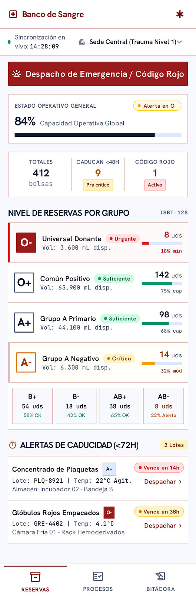
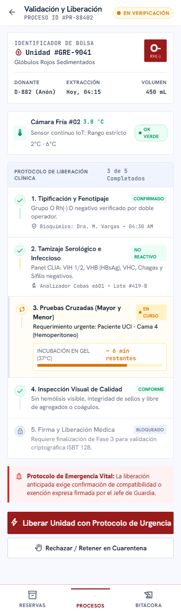
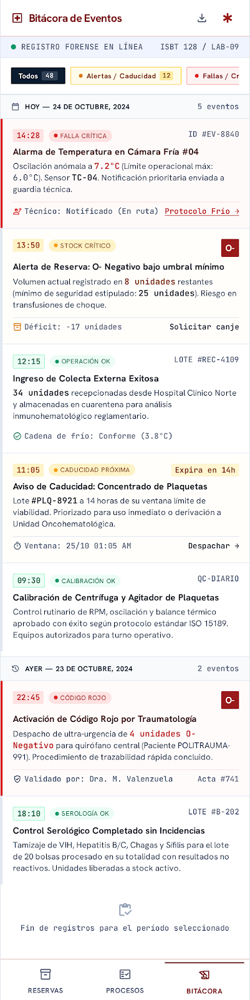

# Diseño de interfaz — #44 Banco de sangre

Generado con **Google Stitch** a partir del prompt en `PROMPT_STITCH.md`. Tres
pantallas, exportadas como HTML + Tailwind autocontenido (sin build, se abren
directo en el navegador):

| Pantalla | Carpeta | Qué muestra |
|---|---|---|
| Dashboard | `dashboard/` | Capacidad operativa global, niveles por tipo sanguíneo, alertas de caducidad |
| Detalle de unidad | `detalle_unidad/` | El ciclo de vida de una unidad concreta |
| Bitácora | `bitacora/` | Línea de tiempo de eventos: alertas, fallas, ingresos, despachos |

`tokens/design-tokens.yml` trae la paleta de colores y la tipografía que generó
Stitch (nombre del sistema: "Clinical Hematology Precision"), por si se quiere
reutilizar en una futura interfaz real con cowboy.

## Capturas

## Nota honesta: esto es un mockup, no la interfaz real

Stitch generó un diseño vistoso y clínicamente creíble, pero con su propio
vocabulario (certificación ISBT-128, protocolos de 5 pasos con firma médica,
nombres de personal de laboratorio) que **no corresponde literalmente** al
modelo de estados que implementamos en Erlang. Antes de usar estas pantallas
como referencia para construir la API real (sección 6.4 del
`PROMPT_OPENCODE.md`), hay que tener claro el mapeo:

| En el mockup de Stitch | En el sistema real (`p44_unidad`) |
|---|---|
| "En Verificación" | `reservada` |
| "Pruebas Cruzadas en curso" | no existe como paso separado — la unidad pasa de `reservada` a `asignada` cuando `p44_unidad:asignar/3` confirma al receptor |
| "Firma y Liberación Médica" | el acto de asignar (`p44_unidad:asignar/3`), que ya verifica caducidad y que quien asigna sea quien reservó |
| "Rechazar / Retener en Cuarentena" | más cercano a `p44_unidad:liberar/1` (vuelve a `disponible`) o a `p44_unidad:comprometer/1` (si es por falla de refrigeración) |
| "Alerta de Reserva: O- bajo umbral" (bitácora) | corresponde a un evento `alerta_critica` de `p44_alertas` |
| "Activación de Código Rojo" (bitácora) | no existe como concepto propio en el backend; la emergencia se modela como una solicitud normal de O negativo sin tipificar (ver supuestos en `README.md`) |

El título y el identificador del encabezado en `detalle_unidad/index.html` se
ajustaron para citar un id real de `p44_unidad` (`p44_unidad_9041`) y su
estado (`reservada`), como ejemplo de cómo debería verse una vez conectada al
backend. El resto del vocabulario clínico (tamizaje serológico, calibración
de centrífuga, etc.) se dejó tal cual lo generó Stitch: es ambientación
visual que no tiene contraparte en el código y no debería presentarse como si
la tuviera.

## Pendiente

La API con cowboy ya está implementada (`GET /api/inventario`,
`POST /api/solicitudes`, SSE en `/api/alertas` y `/metrics`), pero estas
pantallas siguen siendo estáticas (HTML con datos de ejemplo). El paso que
falta es cablearlas a esos endpoints en lugar de los datos de muestra.
